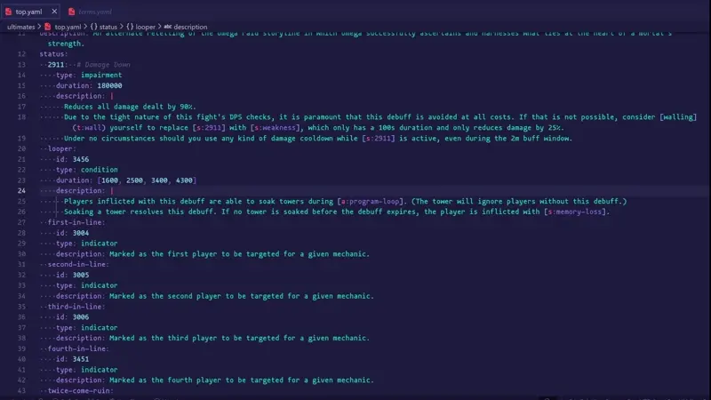

# Thaliak Timeline Linter

A linter (but actually a full-blown language server) for timeline files on [thaliak.com](https://github.com/thaliakcom/data).

Supports code completion, hover, go to definition, find references, various
refactors, and has built-in syntax highlighting.

## Diagrams

`.diagram` files next to a timeline get syntax highlighting, the errors thaliak's build would report, completion,
tooltips, Go to Definition, Find All References, the timeline tree view and hints that show which timeline action a
time is near. Renaming an action or status in the timeline also renames it in the `.diagram` file.

The language's verbs, clauses and `define` fields, with their descriptions, are read from
`schemas/diagram.schema.json` in the data repository, so changing them needs no rebuild of the extension.

Sizes and speeds use the size of the fight's arena image, looked for in `www/` in a folder above the file. Without
game data (below), a telegraph's timing and an action's size aren't checked.

## Game data (optional)

With [ironworks-cli](https://github.com/thaliakcom/ironworks-cli) installed, the extension shows the
in-game names, descriptions and icons of actions and statuses in hovers, tree view tooltips, the tree
view and in front of status keys and `s:` placeholders.

1. Install the CLI: `cargo install --git https://github.com/thaliakcom/ironworks-cli`
2. Set `thaliak-timeline-linter.gameDirectory` to the FFXIV install directory (the one containing
   `boot` and `game`; in WSL, e.g. `/mnt/c/...`).
3. Optionally set `thaliak-timeline-linter.ironworksPath` if the CLI isn't on the `PATH`, and
   `thaliak-timeline-linter.cachePath` to change the directory in which the game data is cached.

The first lookups run the CLI (about 0.1 to 0.3 s per action, status or icon); results are cached.
